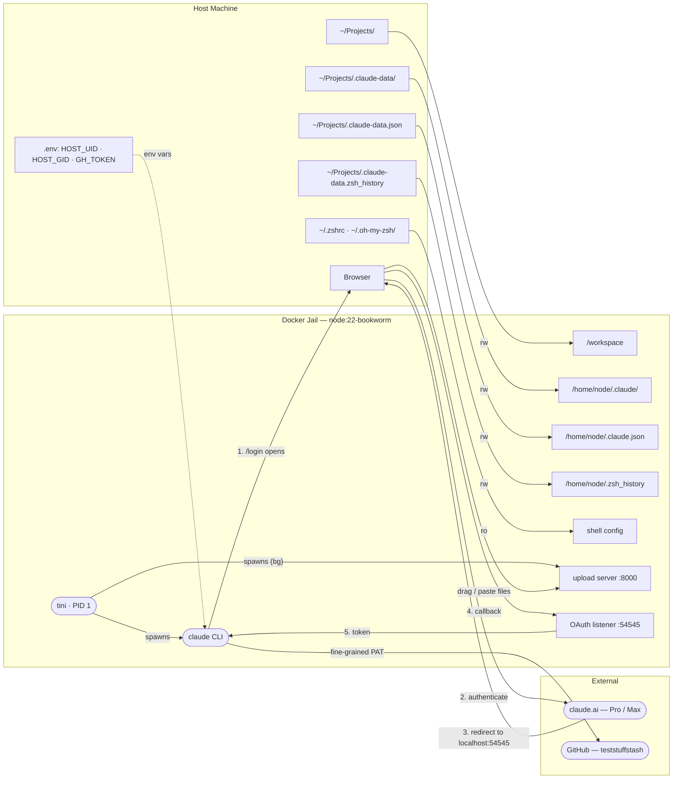

# Claude Code — Docker Jail

## Native Codex jail

Codex has a standalone launcher and Compose file. It shares the image toolchain
and upload server with Claude, but keeps its own configuration, authentication,
and session state. No stack registry or platform workflow is required.

```bash
tools/codex-jail.sh --project /path/to/repo --name my-repo --build
tools/codex-jail.sh --project /path/to/repo --name my-repo --login
tools/codex-jail.sh --project /path/to/repo --name my-repo
tools/codex-jail.sh --project /path/to/repo --name my-repo -- codex resume --last
```

Login uses the **ChatGPT subscription**, with device authentication (enable device
code login in your ChatGPT security settings). Follow the URL and code printed by
Codex. There is no callback port or host-auth copy. See the official
[authentication documentation](https://learn.chatgpt.com/docs/auth).

Each name persists a complete `CODEX_HOME` in `.codex-jail/<name>/` (gitignored,
created mode 0700). Use the same name and project for resume; switching the project
under an existing name is rejected. Config is seeded once with ChatGPT-only login
and file credential storage. The launcher adds
`--dangerously-bypass-approvals-and-sandbox` to Codex commands, including resume
and exec: Docker is the permission boundary, matching the Claude jail's bypass
mode. Model selection retains its CLI default. Pass Codex options after `--`
as needed. This mounts the selected
project read-write at `/workspace/<repository-name>` (for example, `/workspace/homelab`), the jail state, and the existing shared
`/nix` store. Selecting the Projects root exposes its entire contents, just as the
Claude mono jail does. Select an individual repository for a narrower mount. `--mono` mounts the entire
Projects/jail repository at `/workspace` while keeping the selected project as the
working directory. The `homelab-codex` alias uses this mode, matching Claude
`homelab` and `homelab-go`, so sibling projects are visible.

The `homelab-codex` alias also enables `--homelab-wallet`, mounting the existing
`.claude-data/homelab-keepass` and `.claude-data/homelab-pve-ssh` directories read-only
at their matching `/home/node/.claude/` paths. The launcher checks the database,
keyfile, and SSH key exist before starting. Restore missing cache files on the host
with `CLAUDE_CRED_DIR=~/Projects/.claude-data bash ~/Projects/homelab/scripts/wallet-files.sh`.
Other service files regenerated inside the jail persist in
`.codex-jail/<name>/service-credentials`, mounted at `~/.claude`; the wallet and
management key remain read-only overlays. Mono mode also mounts the existing
`.claude-data.gitconfig` read-only when present, matching the Claude jail identity.

When homelab is mounted, startup links `/home/node/.agents/skills` to
`/workspace/homelab/.claude/skills`. This container-local link exposes the skills
to Codex without modifying homelab’s `.agents` directory. Existing user skill
directories are preserved.

At startup, the mono homelab seat refreshes `CLAUDE.local.md` directly from
`agents/jail-seat-card.md`, then merges `CLAUDE.md` and `CLAUDE.local.md` into
`AGENTS.md`. Generated files are replaced atomically and `AGENTS.md` is locally
ignored through `.git/info/exclude`. A missing seat source or hand-written local
card stops startup rather than silently using stale content. Other project
launches merge their existing Claude files without importing homelab procedure.

Native or tracked `AGENTS.md` files are preserved and used as-is; startup reports
that the Claude merge was skipped. `AGENTS.override.md` still takes precedence.
A separate small container environment card is refreshed in `$CODEX_HOME/AGENTS.md`
unless you already maintain that file yourself. Claude-specific tools/hooks are
not translated by this merge; Codex's instruction size limit still applies.

The upload inbox is `uploads/` within the selected project. Its UI is available at
`http://127.0.0.1:8021`; use `--port` for concurrent jails. `--shell` opens zsh.
Container shutdown uses the existing tini process-group forwarding mechanism.

`--env-file /path/to/runtime.env` explicitly injects runtime-provisioned variables
(requires Compose with `run --env-from-file`). The `homelab-codex` alias passes `~/Projects/.env`, matching the Claude mono-jail.
Other launches only read a runtime env file when explicitly supplied. The launcher
does not mint tokens or copy host credentials. `GH_TOKEN`, when provisioned,
uses a container-local git credential store. Set git author identity in the project
or through runtime `GIT_AUTHOR_*`/`GIT_COMMITTER_*` variables. Other service variables
are available to the runtime; existing stack-specific kube provisioning is not
automatically run by this standalone launcher.

For optional Codex OTLP logs, edit `.codex-jail/<name>/config.toml` after first launch
using the actual runtime-provisioned endpoint and authentication:

```toml
[otel]
environment = "jail"
log_user_prompt = false
exporter = { otlp-http = { endpoint = "https://YOUR-COLLECTOR/v1/logs", protocol = "binary" } }
```

This is native Codex telemetry, with different event names and accounting from
Claude. See [official telemetry configuration](https://learn.chatgpt.com/docs/config-file/config-advanced).
Collector delivery, Garage transcript sync, monitor signals, and Claude transcript
consumers still need runtime verification/adapters; persisting `CODEX_HOME` does
not upload transcripts. Never upload the entire state directory: it contains auth.
The tracked jail source has no transcript-sync implementation to reuse.

Builds pin Codex **0.155.1**; set `CODEX_VERSION` explicitly to test an upgrade. `.dockerignore` limits the build context to image inputs,
excluding runtime secrets and sibling checkouts. Local launcher checks:
`python3 tools/test_codex_jail.py` and `python3 tools/test_codex_context.py`. After building the `codex-jail-codex` image,
run `python3 tools/test_codex_container.py` for offline container smoke tests
(temporary fixture mounts only). Verified with Codex 0.155.1 and Claude 2.1.278.

Runs Claude Code in an isolated Docker container with full permissions, persistent memory, and host file access. Files written inside the container are owned by your host user.

## Architecture



Claude runs as a non-root user with your host UID/GID — files created in `/workspace` appear on the host owned by you, no `chown` needed. The `node` user has passwordless sudo so packages can be installed mid-session (`sudo apt-get install ...`); such installs live only in the container's writable layer and are lost on rebuild, so add anything you want to keep to the `Dockerfile`. Note that since `node` is remapped to host UID/GID, sudo→root inside the container has host-root reach over the mounted `~/Projects`.

## Bootstrap

### 1. Build

```bash
./setup-env.sh
docker compose build
```

`setup-env.sh` writes your UID/GID to `.env` and generates `docker-compose.override.yml` with whichever zsh dotfiles exist on your host. Re-run it if your dotfiles change.

### 2. Run

Use the `main` alias from `.aliases` (it publishes the upload + OAuth ports):

```bash
main   # = docker compose run --rm -p 8000:8000 -p 54545:54545 claude
```

For project sessions use the other `.aliases` shortcuts (`car-fleet`, `homelab`, `life`) — see [Upload server & ports](#upload-server--ports). Compose itself declares no `ports:`; each alias publishes its own with `-p`.

### 3. Log in

From the **main** jail (it's the only session that maps the OAuth callback port `54545`), run:

```
/login
```

This authenticates via your claude.ai account (Pro or Max). The token is persisted in `~/Projects/.claude-data/` and reused by every other session — you only log in once.

### 4. GitHub CLI (optional)

GitHub doesn't support pre-selecting fine-grained token permissions via URL, so you'll need to configure these manually.

**First, enable fine-grained PATs in your org:**
`https://github.com/organizations/teststuffstash/settings/personal-access-tokens`
→ Allow access via fine-grained personal access tokens

**Then create the token:**
[Open token creation →](https://github.com/settings/personal-access-tokens/new?description=claude-jail&resource_owner=teststuffstash)

Configure it as follows:

| Field | Value |
|---|---|
| Resource owner | `teststuffstash` |
| Repository access | All repositories |
| Administration | Read and Write |
| Contents | Read and Write |
| Issues | Read and Write |
| Metadata | Read (auto) |
| Pull requests | Read and Write |
| Workflows | Read and Write |
| Everything else | No access |

Then add it to `.env`:

```bash
GH_TOKEN=github_pat_...
```

Repo deletions are recoverable — org owners can restore deleted repos via GitHub settings for 90 days.

## What's inside

| Path (container) | Path (host) | Notes |
|---|---|---|
| `/workspace` | `~/Projects` | Read-write. Your working directory. |
| `/home/node/.claude/` | `~/Projects/.claude-data/` | Memory, history, settings. |
| `/home/node/.claude.json` | `~/Projects/.claude-data.json` | Onboarding state (theme, startup count). |
| `/home/node/.zsh_history` | `~/Projects/.claude-data.zsh_history` | Shell history. |
| `/home/node/.gitconfig` | `~/Projects/.claude-data.gitconfig` | Jail-only git identity; host `~/.gitconfig` is intentionally not mounted. |
| `/home/node/.zshrc` | `~/.zshrc` | Read-only. |
| `/home/node/.oh-my-zsh/` | `~/.oh-my-zsh/` | Read-write (plugin installs persist). |

## Upload server & ports

`tini` runs as PID 1 and auto-starts the file-drop upload server (`tools/upload/upload.py`) in the background before launching `claude` — see `tools/jail-entrypoint.sh`. It lets you paste/drag screenshots and docs from the host into the jail. Dropped files land in each project's gitignored `uploads/` inbox; move them out of `uploads/` to commit. Details in `tools/upload/README.md`.

To run several sessions at once without port clashes, the **container** always serves the upload UI on `8000` while each alias publishes its own **host** port with `-p` (compose declares no `ports:`):

| Session | Upload UI (host) | OAuth (host) |
|---|---|---|
| `main` (`~/Projects`) | `localhost:8000` | `54545` ← log in here |
| car-fleet | `localhost:8001` | — |
| homelab | `localhost:8002` | — |
| life | `localhost:8003` | — |

The **main** jail runs from `~/Projects` for general/infra work and is the only session that maps the OAuth port, so it's the only one that can complete `/login` (the callback is fixed to `localhost:54545`). The project jails don't publish it at all. Log in once via `main`; the token persists in `.claude-data/` and works in every other session.

## Cross-jail handoff

During big platform rollouts a stack session (e.g. oracle) often needs quick homelab-side work
from the mono session without GitHub-issue latency or copy-pasting between terminals. A shared
file-drop channel covers this: the stack jail writes task files to `/workspace/.handoff/inbox/`
(host `~/Projects/.handoff/<stack>/`, mounted per stack by `tools/stack-jail.sh`), and the mono
session processes them with `/handoff` — typically looped, `/loop /handoff`. Results come back in
`done/`. Protocol, file format, and boundaries: [`tools/handoff.md`](tools/handoff.md). It's a
speed channel for attended sessions, not a tracker — durable outcomes still land in issues/docs.

## Re-running

```bash
main        # general/infra jail (also where you /login)
car-fleet   # or homelab / life
```

No rebuild needed unless you update the `Dockerfile`. Re-run `setup-env.sh` if your zsh dotfiles change.
